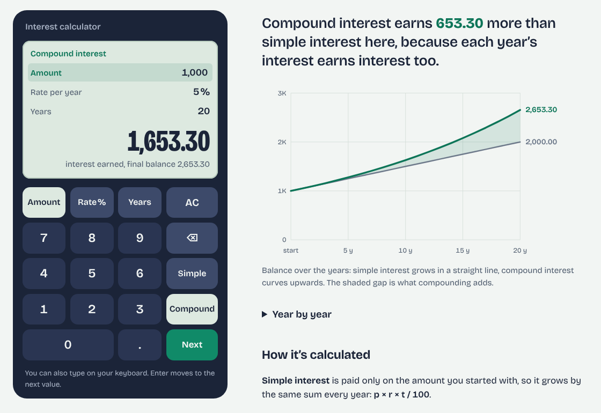

# Interest Calculators

[](https://github.com/AnnaTverdovska/jbbmo-Introduction-to-Git-and-GitHub/actions/workflows/ci.yml)

Interest calculators: a web page, plus two small command-line versions in Bash and
Python. The repository started as the lab project of the IBM *Introduction to Git and
GitHub* course; the original scripts are by Upkar Lidder (IBM).

[](https://annatverdovska.github.io/jbbmo-Introduction-to-Git-and-GitHub/)

| Script | Calculates | Formula |
|---|---|---|
| `simple-interest.sh` | simple interest | `p × r × t / 100` |
| `compound_interest.py` | compound interest, compounded yearly | `p × (1 + r/100)^t − p` |

`p` is the principal, `r` the annual interest rate in percent and `t` the time in years.

## Web version

**[Open the calculator](https://annatverdovska.github.io/jbbmo-Introduction-to-Git-and-GitHub/)**: type in an
amount, a yearly rate and a number of years, switch between simple and compound interest, and
see on a chart how far compounding pulls ahead, year by year.

It is a static page in [`docs/`](docs) (HTML, CSS and JavaScript, no build step), served by
GitHub Pages. The formulas live in [`docs/interest.js`](docs/interest.js) and are tested against
the same numbers as the command-line scripts. To try it locally:

```bash
python -m http.server --directory docs
# then open http://localhost:8000
```

## Command-line usage

Both scripts ask for the values when started without arguments, or take them on the
command line:

```bash
./simple-interest.sh 1000 5 2             # principal, rate %, years
# The simple interest is: 100.00

python compound_interest.py 1000 2 5      # principal, years, rate %
# The compound interest is 102.50
# The final amount is 1102.50
```

Decimal values are supported; negative numbers and text are rejected. Note the
argument order: the Python script keeps the original `p, t, r` order.

## Running the tests

```bash
bash tests/test-simple-interest.sh
pip install pytest && pytest
node --test tests/interest.test.mjs
```

The tests and [ShellCheck](https://www.shellcheck.net/) run on every push and pull
request through GitHub Actions.

## Contributing

See [CONTRIBUTING.md](CONTRIBUTING.md) and the [Code of Conduct](CODE_OF_CONDUCT.md).

## Changes to the IBM lab

This repository is a fork of IBM Skills Network's `jbbmo-Introduction-to-Git-and-GitHub` lab,
licensed under the Apache License 2.0. All changes were made in 2026 by AnnaTverdovska and are
listed in the commit history. Changed from the original: `README.md`, `CONTRIBUTING.md`,
`CODE_OF_CONDUCT.md`, `.gitignore`, `simple-interest.sh` and `compound_interest.py` (both also
note their changes in their first lines); removed: `.github/workflows/close_pr.yml`. Everything
in `docs/` and `tests/` and the CI workflow are new.

## License

[Apache License 2.0](LICENSE). Original lab material © IBM Developer Skills Network.
The web page uses the [Bricolage Grotesque](https://github.com/ateliertriay/bricolage) typeface,
included under the [SIL Open Font License](docs/fonts/OFL.txt).
